

<a href="https://hassanireza.github.io/">
  
</a>

  

<a href="https://hassanireza.github.io/">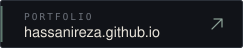</a>
<a href="https://hassanireza.github.io/descent">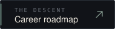</a>

 

 

## &nbsp;&nbsp;About

<table>
<tr>
<td width="65%" valign="top">

I build production-grade interfaces where technical rigor meets visual craft: component architecture, design systems, motion, and full-stack integration, with accessibility and performance treated as requirements rather than finishing touches.

I work the seam between mockup and shipped product, holding engineering discipline and design judgment to the same standard so the distance between the two stays as close to zero as possible.

</td>
<td width="35%" valign="top">

 <b>Core Strengths</b>

<table>
<tr><td width="36" valign="top"></td><td valign="top">Design-to-code, Figma to production CSS</td></tr>
<tr><td width="36" valign="top"></td><td valign="top">Accessible, responsive interface engineering</td></tr>
<tr><td width="36" valign="top"></td><td valign="top">Motion and interaction design</td></tr>
<tr><td width="36" valign="top"></td><td valign="top">Design systems at scale</td></tr>
<tr><td width="36" valign="top"></td><td valign="top">Django and Wagtail integration</td></tr>
</table>

</td>
</tr>
</table>

 

## &nbsp;&nbsp;Portfolio Website

<a href="https://hassanireza.github.io/">
  
</a>

 

 <b>What it does</b>

<table width="100%">
<tr><td width="36" valign="top"></td><td valign="top">Landing page with a canvas-based particle field animation</td></tr>
<tr><td width="36" valign="top"></td><td valign="top">A portfolio grid pulling from a single typed data source, so adding a project is a two-line edit, not a layout change</td></tr>
<tr><td width="36" valign="top"></td><td valign="top">A contact form protected by Cloudflare Turnstile, submitting through Formspree</td></tr>
<tr><td width="36" valign="top"></td><td valign="top">A branded 404 page for any unmatched route, styled to match the rest of the site</td></tr>
<tr><td width="36" valign="top"></td><td valign="top">Zero manual deploys: CI lints, type-checks, builds, and publishes on every push</td></tr>
</table>

 

 <b>Built with</b>

 

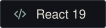 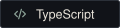 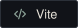 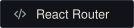 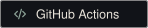 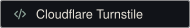

  

<a href="https://hassanireza.github.io/"></a>

 

## &nbsp;&nbsp;Tech Stack

<table align="center">

<tr>
<td align="center" valign="top" width="25%">

 
<b>Front-End</b>
  
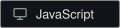 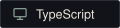 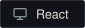 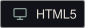 

</td>
<td align="center" valign="top" width="25%">

 
<b>Back-End &amp; CMS</b>
  
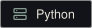 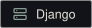 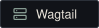 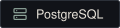

</td>
<td align="center" valign="top" width="25%">

 
<b>Design &amp; Creative</b>
  
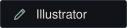 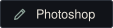 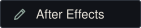 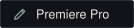

</td>
<td align="center" valign="top" width="25%">

 
<b>Tooling</b>
  
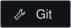 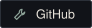 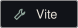

</td>
</tr>

</table>

 

## &nbsp;&nbsp;Design Philosophy

<table align="center">
<tr>
<td align="center" width="25%" valign="top">

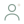
 
<b>User-First</b>
 
Every decision traces back to how someone actually interacts with the product.

</td>
<td align="center" width="25%" valign="top">

 
<b>Component Integrity</b>
 
Clean abstractions and consistent patterns that scale without friction.

</td>
<td align="center" width="25%" valign="top">

 
<b>Accessible by Default</b>
 
Not a finishing touch. A baseline requirement from day one.

</td>
<td align="center" width="25%" valign="top">

 
<b>Performance as UX</b>
 
Speed and responsiveness are features, not post-launch fixes.

</td>
</tr>
</table>

 


 

> *"The best interfaces feel effortless. Getting there takes everything."*

 

## &nbsp;&nbsp;Brand &amp; Art Direction

 

Every project I ship carries a written brand system before a single line of interface code, defining palette, typography, tone, and the rules that keep a visual identity disciplined instead of decorative. The direction below governs **Abyssal Liturgy**, a ceremonial identity built for the edge of land and sea, where fashion, ritual, and biological form are treated as forgotten religious painting, submerged for centuries.

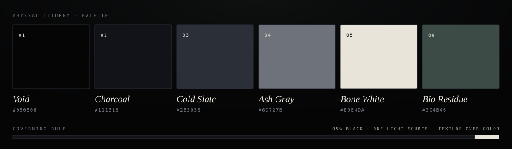

 

**Governing rule:** ninety-five percent black, one light source, texture over color as the primary signal.

<a href="https://hassanireza.github.io/branding">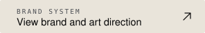</a>

 

## &nbsp;&nbsp;Highlighted Project

<a href="https://woodlandchess.github.io/">
  
</a>

  

### [Woodland Chess](https://woodlandchess.github.io/)
Mobile-first chess app | Stockfish in WebAssembly, Lichess integration, live demo

A chess application built on the same premise as everything above: restraint is a design choice, not an absence of one. Woodland Chess has three modes that share one visual language, and it inherits the Abyssal Liturgy system directly, with near-black surfaces, Cormorant Garamond italics, one 24px icon family and a 2px radius. Every colour, spacing value and easing curve lives as a CSS custom property.

<table>
<tr><td width="36" valign="top"></td><td valign="top"><b>Computer.</b> Stockfish 18 Lite running locally as WebAssembly</td></tr>
<tr><td width="36" valign="top"></td><td valign="top"><b>Online.</b> Live games through the Lichess Board API</td></tr>
<tr><td width="36" valign="top"></td><td valign="top"><b>Puzzles.</b> Rated tactics from the Lichess puzzle database</td></tr>
</table>

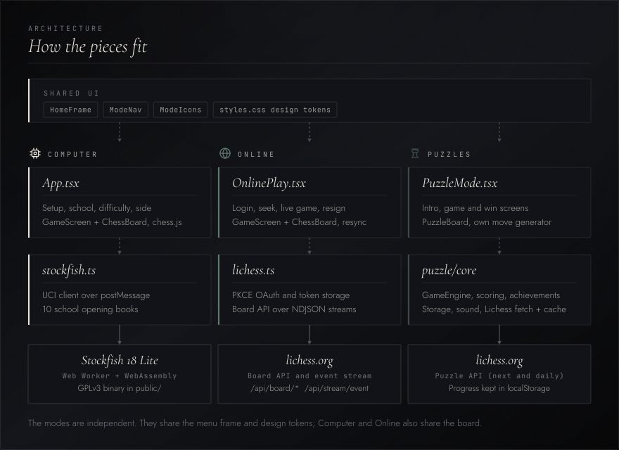

 

The front end is a strict-TypeScript React SPA served from Vite, with History API routing and no router dependency. There is no backend of our own: Computer mode makes no network calls beyond loading fonts, online play uses OAuth with PKCE straight from the browser, and puzzles read the public Lichess API. A thin shared layer (menu frame, mode navigation, design tokens) sits under three independent modes: `chess.js` and a Stockfish UCI client for Computer, an NDJSON stream reader for Online, and a state-machine puzzle engine with scoring, streaks and achievements. CI tests, builds and deploys to GitHub Pages on every push.

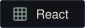 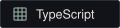 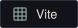 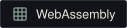 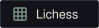 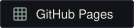

  

<a href="https://woodlandchess.github.io/"></a>
<a href="https://github.com/woodlandChess/woodlandChess.github.io">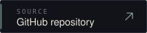</a>

 

  
Reza Hassani &nbsp;&middot;&nbsp; Front-End Developer &nbsp;&middot;&nbsp; UI/UX Designer &nbsp;&middot;&nbsp; Creative Technologist

